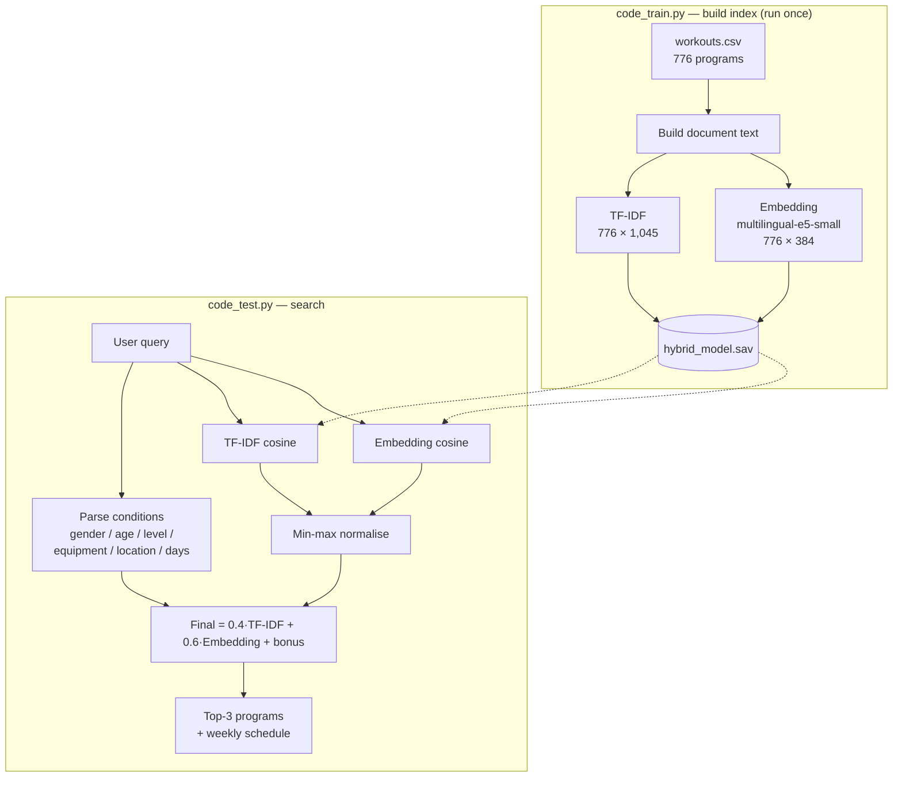

# Workout Hybrid Search 🏋️

A Thai/English search engine that recommends workout programs from a plain-language request, for example *"ผู้หญิง อายุ 25 อยากลดน้ำหนักที่บ้าน 3 วัน"* or *"build muscle with dumbbells 4 days a week"*. It returns the 3 best-matching programs with a day-by-day training schedule.

The ranking combines **TF-IDF** (written from scratch) for exact keyword matching with **multilingual text embeddings** for meaning. On top of that, a rule-based query parser adds a bonus to programs that match the user's gender, age, level, equipment, location, and training days.

> ระบบค้นหาโปรแกรมออกกำลังกายด้วย Hybrid Search (TF-IDF + Embedding) รองรับภาษาไทยและอังกฤษ พิมพ์สิ่งที่ต้องการเป็นภาษาธรรมดา ระบบแนะนำ 3 โปรแกรมที่เหมาะที่สุดพร้อมตารางฝึกรายวัน

## How it works



### 1. TF-IDF (hand-written, no scikit-learn)
- **Tokenizer:** English words are lower-cased, stop words are removed, and a simple suffix stemmer is applied (`squats → squat`, `running → run`). Thai has no spaces between words, so Thai text is cleaned of stop words and split into **character bigrams** (`ลดน้ำหนัก → ลด, ดน, น้, ...`).
- **Weighting:** TF = term count ÷ document length; IDF = `ln((N+1)/(df+1)) + 1`; vectors are L2-normalised so cosine similarity is a dot product.
- **Field boosting:** program name and goal are repeated ×3; focus areas, equipment, and tags ×2.

### 2. Text embedding
- Model: [`intfloat/multilingual-e5-small`](https://huggingface.co/intfloat/multilingual-e5-small) (384 dimensions, supports Thai).
- Documents are encoded with the `passage: ` prefix and queries with `query: `, as the E5 model requires.
- Lets the system match meaning across wording and language, e.g. *"ลดน้ำหนัก"* ↔ *"fat loss"*.

### 3. Hybrid score + condition bonus
```
Final = 0.4 × MinMax(TF-IDF) + 0.6 × MinMax(Embedding) + Bonus
```
Bonus weights: age 0.20, gender 0.15 (unisex programs get half), level 0.10, equipment 0.10, location 0.05, days per week 0.05. Age and gender weigh the most because they affect safety and suitability. A bonus is used instead of a hard filter, so the search always returns results.

## Dataset

`workouts.csv`: **776 programs × 23 columns** (bilingual EN/TH).

| Field group | Columns |
|---|---|
| Identity | `program_id`, `program_name`, `program_name_th` |
| Goal (17 goals) | `goal`, `goal_en`, `goal_th` |
| Audience | `gender` (female/male/unisex), `age_group`, `age_range` (13-17 … 60+) |
| Difficulty | `level`, `intensity` |
| Format | `days_per_week` (2–6), `minutes_per_session` (20–90), `program_weeks` (4/6/8/12) |
| Equipment | `equipment`, `equipment_detail`, `location` (home/gym/outdoor) |
| Content | `focus_areas(_th)`, `description(_th)`, `tags`, `weekly_schedule` |

**This dataset is synthetic.** Exercise ideas came from personal knowledge and fitness content on social media (TikTok, Instagram, YouTube clips). The dataset was then expanded with AI assistance (Claude) using `generate_dataset.py`, a rule-based generator with a fixed random seed. The generator covers every valid goal × gender × age-group combination (194 groups × 4 programs), and its safety rules exclude unsuitable combinations, such as no high-impact moves for seniors and beginners and postnatal programs for women only. Programs draw on an exercise library of 259 movements.

⚠️ The programs have **not** been reviewed by a fitness or medical professional. They are intended for testing the search algorithm, not as training advice.

## Run it

```bash
pip install -r requirements.txt

# (optional) regenerate the dataset → workouts.csv
python3 generate_dataset.py

# build the index → hybrid_model.sav  (downloads the embedding model on first run)
python3 code_train.py

# interactive search: type a query, press Enter on an empty line to run 6 examples, type q to quit
python3 code_test.py
```

The repo already includes a pre-built `hybrid_model.sav`, so you can go straight to `code_test.py`. If `sentence-transformers` is not installed, both scripts fall back to TF-IDF-only search.

### Example: query understanding

| Query | Detected conditions |
|---|---|
| ผู้หญิง อายุ 25 อยากลดน้ำหนัก 3 วัน | `gender=female, age_group=young_adult, days_per_week=3` |
| kettlebell swing for fat loss beginner | `level=beginner, equipment=(kettlebell, full_gym)` |
| ลดน้ำหนักที่บ้าน ไม่มีอุปกรณ์ | `equipment=(bodyweight, outdoor), location=home` |

## Files

| File | Purpose |
|---|---|
| `generate_dataset.py` | Generates the synthetic dataset (`workouts.csv`) |
| `workouts.csv` | 776 workout programs |
| `code_train.py` | Builds the TF-IDF + embedding index and saves it to `hybrid_model.sav` |
| `code_test.py` | Loads the index, parses the query, and runs the hybrid search |
| `hybrid_model.sav` | Pre-built index (pickle) |

## Limitations
- Thai character bigrams are dictionary-free but can match unrelated words that share two letters.
- Weights (0.4 / 0.6 and the bonus values) were set by design, not tuned on a labelled query set. A natural next step is to build test queries with expected answers and measure Precision@3.
- The data is synthetic and not expert-reviewed.

---
Course project, B.Sc. Data Science and Innovation, College of Interdisciplinary Studies, Thammasat University.
